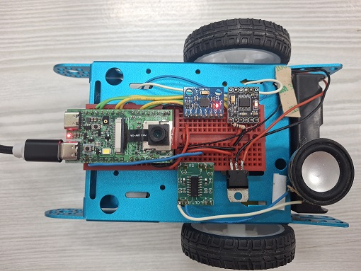

# RoboCar with Gemma4-VLA

## System Hardware
1. HUB8735-ultra board which has camera to capture image, mic to record audio, and audio out to play mp3 file
2. DRV8833 to drive two DC motors for its two wheels
3. MPU6050 for heading angle 
4. PAM8403 for audio output amplifier with 8 ohm speaker

## Features
Ollama server is running Gemma-4-E2B-it remotely on a PC or Android phone to serve Text/Image/Audio 
1. Initialize DRV8833, MPU6050, then flash LED twice to indicate the RoboCar is ready.
2. RoboCar report its status by TTS to speak out, and display on its HTTP server
3. RoboCar status reports the IMU heading angle (Yaw); the "scene" command captures an image for scene recognition by Ollama server (refer to Ollama_sendImage.ino)
4. User can use voice,  serial-port or http server to send command to control the RoboCar (refer to Ollama_sendAudio.ino)
5. RoboCar two-wheel control per 1 second movement then stop to recognize the scene for positioning itself.
6. prompt need to tell Ollama server the output command format required for RoboCar
7. RoboCar navigation is guided by image scene recognition, so RoboCar need to capture image periodically to recognize the place by Ollama LLM, 
prompt need to provide the navigation route (such as from Living room go to Kitchen, or from Kitchen go to Bedroom)
8. RoboCar can perform the command "find the dog" by looking around and stop RoboCar when the dog is found, and play TTS to inform I found the dog.
